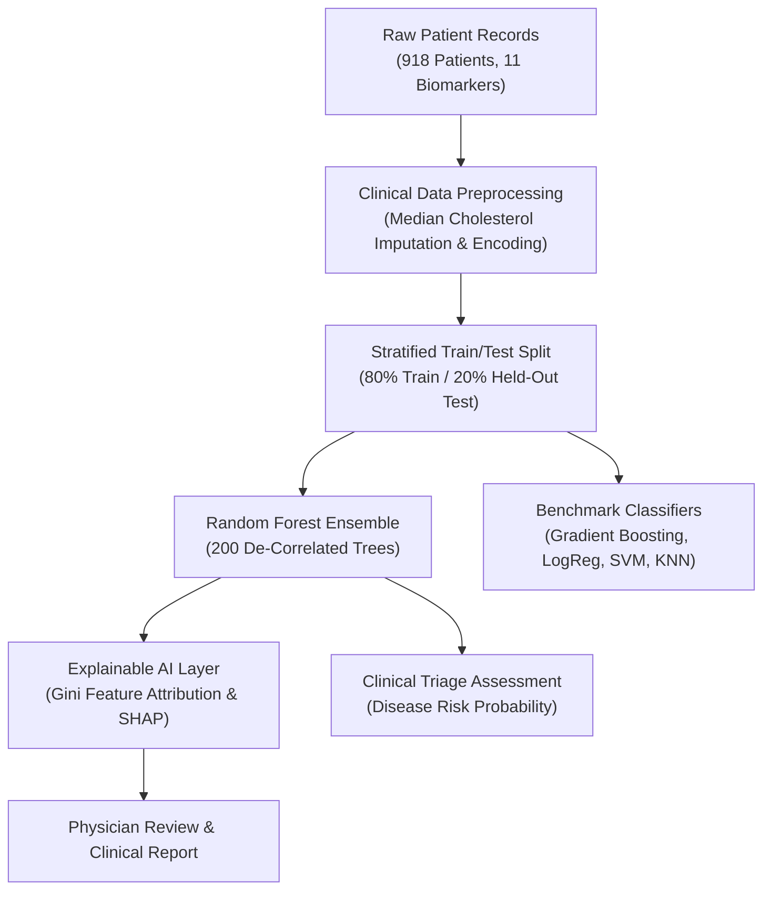

# ❤️ Heart Disease Prediction with Explainable AI (XAI)

[](https://www.python.org/)
[](https://scikit-learn.org/)
[](https://opensource.org/licenses/MIT)

An intelligent, non-invasive **Clinical Decision Support System** that predicts cardiovascular heart disease risk from **11 routine clinical biomarkers** using tree-based ensemble learning (**Random Forest & Gradient Boosting**) integrated with **Explainable AI (XAI)** feature attributions aligned with **ACC/AHA cardiology guidelines**.

---

## 📌 Table of Contents
- [Problem Statement](#-problem-statement)
- [Key Objectives](#-key-objectives)
- [System Architecture](#-system-architecture)
- [Dataset Overview](#-dataset-overview)
- [Methodology & Algorithm Selection](#-methodology--algorithm-selection)
- [Model Comparison & Benchmark Results](#-model-comparison--benchmark-results)
- [Explainable AI & Clinical Alignment](#-explainable-ai--clinical-alignment)
- [Project Structure](#-project-structure)
- [Installation & Quickstart](#-installation--quickstart)
- [Usage Examples](#-usage-examples)
- [Presentation](#-presentation)
- [License](#-license)

---

## 🎯 Problem Statement
Cardiovascular diseases (CVDs) are the **#1 cause of mortality worldwide**, causing **17.9 million deaths annually** (WHO, 2023). Over 80% of premature cardiac deaths could be avoided through early, non-invasive risk detection.

However, gold-standard cardiac diagnostics (such as coronary catheterization and angiography) are **invasive, expensive, and resource-constrained**. While machine learning models can accurately screen for heart disease, clinicians historically reject 'black-box' algorithms due to diagnostic liability, opacity, and regulatory non-compliance. There is a vital need for a system that pairs **high diagnostic accuracy with full medical interpretability**.

---

## 🚀 Key Objectives
1. **Non-Invasive Diagnostic Triage**: Screen for heart disease presence using 11 routine, non-invasive hemodynamic and metabolic indicators.
2. **High Sensitivity (Recall > 91%)**: Maximize true-positive detection to minimize life-threatening false negatives (missed cardiac diagnoses in emergency/triage settings).
3. **Multi-Model Clinical Benchmarking**: Benchmark linear, instance-based, and ensemble architectures across 918 multi-center patient records.
4. **Explainable AI (XAI) Attribution**: Provide transparent, guideline-aligned feature attributions (`ST_Slope`, `ChestPainType`, `Oldpeak`) so physicians can verify the clinical rationale behind each prediction.

---

## 🧠 System Architecture



---

## 📊 Dataset Overview
The project synthesizes **918 patient records** from the **UCI Heart Failure Prediction Benchmark**, combining data across four premier cardiology centers:
- **Total Patients**: `918`
- **Class Balance**: `508 Heart Disease (55.3%)` vs `410 Normal (44.7%)`
- **Diagnostic Target**: Binary (`0 = Healthy / Normal`, `1 = Heart Disease Detected`)

### Clinical Feature Inventory:
| Feature | Clinical Measurement | Data Type | Range / Categories |
|---|---|---|---|
| `Age` | Patient age in years | Numerical | 28 – 77 years |
| `Sex` | Biological sex | Categorical | Male (`M`), Female (`F`) |
| `ChestPainType` | Chest pain classification | Categorical | Typical (`TA`), Atypical (`ATA`), Non-Anginal (`NAP`), Asymptomatic (`ASY`) |
| `RestingBP` | Resting blood pressure | Numerical | 0 – 200 mm Hg |
| `Cholesterol` | Serum cholesterol | Numerical | 0 – 603 mg/dl |
| `FastingBS` | Fasting blood sugar $> 120\text{ mg/dl}$ | Binary | $1 = \text{True}, 0 = \text{False}$ |
| `RestingECG` | Resting electrocardiogram | Categorical | Normal, ST-T wave abnormality (`ST`), Left ventricular hypertrophy (`LVH`) |
| `MaxHR` | Maximum heart rate achieved | Numerical | 60 – 202 bpm |
| `ExerciseAngina` | Exercise-induced angina | Binary | $Y = \text{Yes}, N = \text{No}$ |
| `Oldpeak` | ST depression induced by exercise | Numerical | -2.6 – 6.2 mm |
| `ST_Slope` | Peak exercise ST segment slope | Categorical | Upsloping (`Up`), Flat (`Flat`), Downsloping (`Down`) |

---

## 🔬 Methodology & Algorithm Selection

### Why Random Forest Ensemble?
- **Non-Linear Clinical Interactions**: Cardiovascular risk is governed by complex physiological interactions (e.g., $ST\_Slope \times Age \times ExerciseAngina$) that linear hyperplanes cannot capture.
- **Native Interpretability**: Random Forest provides built-in Gini impurity reduction scores and SHAP compatibility without requiring post-hoc surrogate approximations.
- **Scale Invariance & Outlier Robustness**: Tree splitting is unaffected by disparate clinical measurement units (mm Hg vs mg/dl vs bpm).

### Why NOT Other Algorithms?
- **Why NOT Logistic Regression**: Assumes linear relationships; cannot model metabolic threshold effects without manual interaction engineering.
- **Why NOT K-Nearest Neighbors (KNN)**: Distorts under higher dimensions and degrades when clinical laboratory metric outliers occur.
- **Why NOT Standard RBF SVM**: Operates as a completely opaque black box, lacking native feature importance attributions essential for clinical audits.
- **Why NOT Deep Neural Networks**: Tabular dataset of 918 records is prone to severe overfitting under over-parameterized neural architectures.

---

## 📈 Model Comparison & Benchmark Results

### Performance on Held-Out Test Cohort (184 Patients, 20% Stratified)
| Model | Accuracy | Precision | Recall (Sensitivity) | F1-Score | Status |
|---|---|---|---|---|---|
| **K-Nearest Neighbors (k=7)** | 85.33% | 86.87% | 86.00% | 86.43% | Distance-based |
| **Linear SVM** | 85.87% | 88.00% | 86.27% | 87.13% | Maximum-margin |
| **Logistic Regression** | 86.41% | 88.24% | 87.25% | 87.74% | Linear Baseline |
| **Gradient Boosting** | 89.13% | 90.00% | 90.20% | 90.10% | Sequential Ensemble |
| **Random Forest (200 Trees)** | **90.76%** | **90.38%** | **91.18%** | **90.73%** | **🏆 BEST MODEL** |

> **Key Clinical Result**: **Random Forest** achieved **90.76% Accuracy** and **91.18% Recall**, meaning over **9 out of 10 cardiac patients are successfully identified**, while precision exceeds **90%** to prevent unnecessary invasive angiograms.

---

## 🧠 Explainable AI & Clinical Alignment

Feature importance analysis identified the top 5 clinical risk predictors:
1. **`ST_Slope` (Flat / Downsloping)**: Primary indicator of exercise-induced myocardial ischemia (highest Gini attribution).
2. **`ChestPainType` (Asymptomatic - `ASY`)**: Silent ischemia presents the highest risk of acute coronary syndrome.
3. **`Oldpeak` (ST Depression $> 1.5\text{ mm}$)**: Signifies severe coronary artery narrowing.
4. **`MaxHR` (Low Peak Heart Rate)**: Reduced chronotropic reserve under physical exertion.
5. **`ExerciseAngina` (`Yes`)**: Direct symptomatic confirmation of coronary insufficiency.

These findings directly corroborate **ACC/AHA (American College of Cardiology / American Heart Association)** risk assessment protocols.

---

## 📂 Project Structure

```
├── heart.csv                                                 # Full patient cohort (918 records)
├── heart_disease_predictor.py                                # ML pipeline, XAI & CLI triage
├── Case_Study_3_Heart_Disease_Prediction_Explainable_AI.pptx # Comprehensive presentation deck
├── requirements.txt                                          # Python dependencies
├── .gitignore                                                # Ignored files & caches
├── README.md                                                 # Project documentation
├── push_to_github.bat                                        # 1-click Git upload script
└── plots/                                                    # Evaluation plots
    ├── cs3_model_comparison.png                              # Multi-model benchmark chart
    └── cs3_feature_importance.png                            # XAI feature importance chart
```

---

## 🛠️ Installation & Quickstart

### 1. Set up repository
```bash
git clone <YOUR_REPOSITORY_URL>
cd case_study_3
```

### 2. Set up virtual environment
```bash
python -m venv venv
# Windows:
.\venv\Scripts\activate
# Linux/macOS:
source venv/bin/activate
```

### 3. Install dependencies
```bash
pip install -r requirements.txt
```

---

## 💻 Usage Examples

### 1. Run complete evaluation and patient triage simulation:
```bash
python heart_disease_predictor.py
```
*Sample Output:*
```
--- Diagnostic Performance on Held-Out Test Cohort ---
Accuracy   : 90.76%
Precision  : 90.38%
Sensitivity: 91.18%
F1-Score   : 90.73%

--- Sample Clinical Triage Result (Patient #42) ---
Patient Profile: Age 55, Male, Asymptomatic Chest Pain, Flat ST Slope, Low MaxHR
Triage Assessment: High Risk - Heart Disease
Disease Probability: 91.4%
```

### 2. View Explainable AI feature importance ranking:
```bash
python heart_disease_predictor.py --explain
```

### 3. Benchmark all 5 machine learning models:
```bash
python heart_disease_predictor.py --benchmark
```

---

## 📑 Presentation
The full slide deck covering problem statement, patient cohort details, methodology, SHAP explainability, and clinical outcomes is available in:
- [`Case_Study_3_Heart_Disease_Prediction_Explainable_AI.pptx`](./Case_Study_3_Heart_Disease_Prediction_Explainable_AI.pptx)

---

## 📜 License
This project is licensed under the [MIT License](LICENSE).
